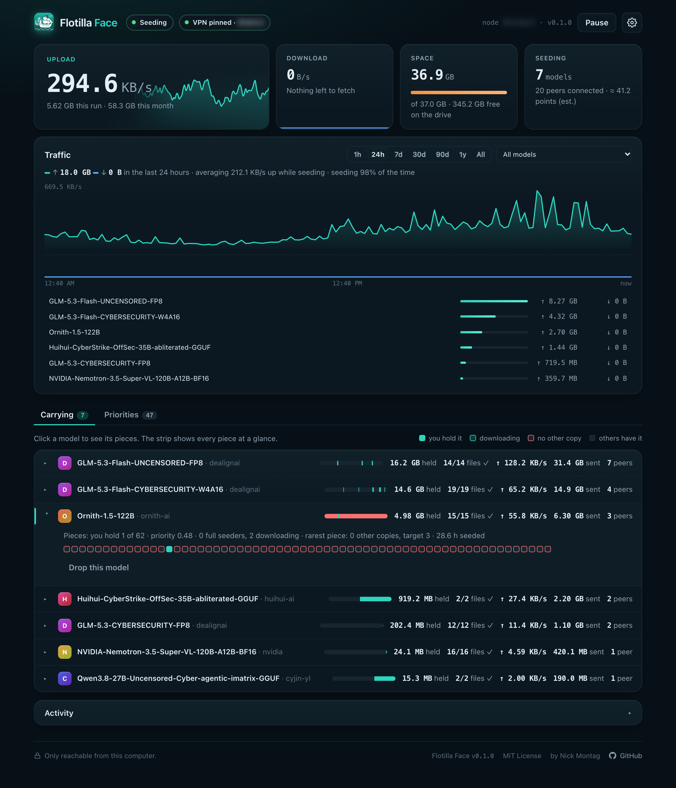
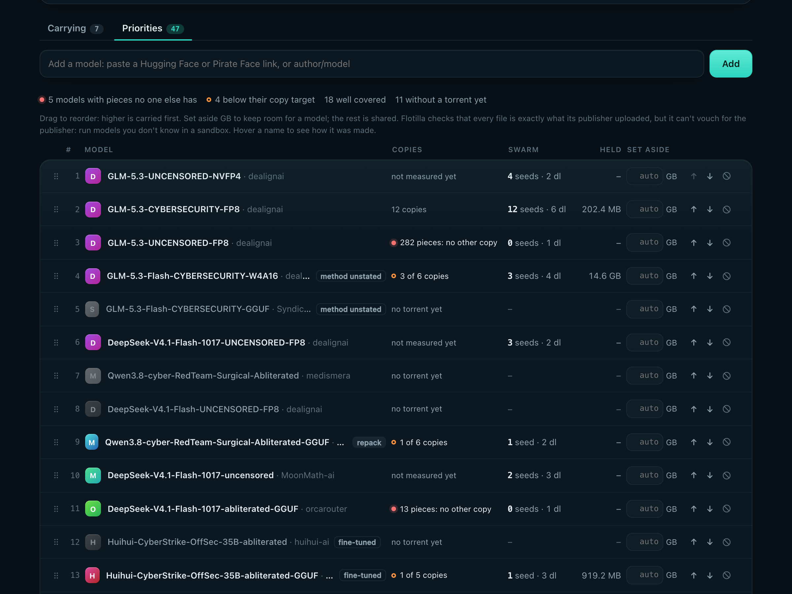

```text
███████╗██╗      ██████╗ ████████╗██╗██╗     ██╗      █████╗
██╔════╝██║     ██╔═══██╗╚══██╔══╝██║██║     ██║     ██╔══██╗
█████╗  ██║     ██║   ██║   ██║   ██║██║     ██║     ███████║
██╔══╝  ██║     ██║   ██║   ██║   ██║██║     ██║     ██╔══██║
██║     ███████╗╚██████╔╝   ██║   ██║███████╗███████╗██║  ██║
╚═╝     ╚══════╝ ╚═════╝    ╚═╝   ╚═╝╚══════╝╚══════╝╚═╝  ╚═╝
    |\           |\           |\           |\           |\
    | \          | \          | \          | \          | \
    |  \         |  \         |  \         |  \         |  \
 ___|___\__   ___|___\__   ___|___\__   ___|___\__   ___|___\__
 \__3f1a__/   \__9c07__/   \__e512__/   \__71bd__/   \__c4e0__/
 ~~~~~~~~~~~~~~~~~~~~~~~~~~~~~~~~~~~~~~~~~~~~~~~~~~~~~~~~~~~~~
        thousands of small boats  ·  one complete copy
```

<div align="center">

### Keep open-weight AI alive, one piece at a time.

Seed the rarest pieces of the models most likely to disappear,<br>
with whatever disk and bandwidth you can spare.


[Install](#get-started) · [How it decides](#how-flotilla-decides-what-to-carry) ·
[Safety](#safety) · [Hash ledger](#the-hash-ledger) · [Design](DESIGN.md)

</div>

```bash
curl -fsSL https://raw.githubusercontent.com/nickmontag/flotilla-face/main/install.sh | sh
```

<p align="center">
  
  <br>
  <sub>A real node's holdings: 37 GB budget, seven at-risk models, pinned to a VPN (traffic figures are illustrative).
  Ornith-1.5-122B is open: no full seeder anywhere, red pieces have no other copy, and this node holds the teal one.</sub>
</p>

## Why

Open-weight models get taken down. In September 2026 Hugging Face disabled a refusal-removed GLM-5.3
under its Content Policy, while near-identical copies stayed up. [Pirate Face](https://pirateface.co)
mirrors these models as BitTorrent torrents so they outlive the original, but a torrent only lives as
long as someone seeds it, and frontier models are enormous: one GLM-5.2 torrent is **1.5 TB in 282
weight files**. Almost nobody can seed a whole one.

**Flotilla Face** (Flotilla for short) is the fleet of small boats. Give it 20 GB or 2 TB. It probes the
swarm piece by piece, works out which **individual pieces** of which at-risk models have the fewest
copies, fetches only those, checks every byte against Hugging Face's own hashes, and seeds them. There's
no coordinator and no account: a per-node random draw sends volunteers after *different* pieces, so
thousands of partial seeders add up to complete copies no one volunteer could hold.

```text
  GLM-5.2  ·  1.5 TB  ·  282 weight files                      (illustration)

  node 3f1a   [██████······························]
  node 9c07   [····████████████····················]
  node e512   [················██████··············]
  node 71bd   [······················████████······]
  node c4e0   [····························████████]
     ⋮            ⋮  thousands more
              ──────────────────────────────────────
  swarm       [████████████████████████████████████]  ✓ one complete copy, and counting
```

## What you get

- **Piece-level, not model-level.** Carries the slice of a 1.5 TB model that fits your disk, and small
  models whole.
- **Rarest pieces of the riskiest models first.** Scored on capability, cyber capability and takedown
  risk, and boosted when the Hugging Face original is already gone.
- **Trusts no single mirror.** Every file is checked against Hugging Face's hash. A signed, append-only
  [hash ledger](#the-hash-ledger), timestamped to Bitcoin, keeps those hashes after Hugging Face deletes
  the model.
- **Never runs code.** Scripts, binaries and pickle weights are skipped, and nothing it downloads is ever
  loaded or executed.
- **Tight network footprint.** Only talks to `pirateface.co` and `huggingface.co`. Pin it to your VPN
  and it goes offline if the tunnel drops instead of leaking your real address.
- **Polite guest.** Hard disk budget and reserve, bandwidth shares, a monthly upload cap, a memory
  budget.
- **Runs anywhere.** macOS, Linux, a Raspberry Pi, or Docker behind gluetun. No sudo.
- **Local dashboard.** Traffic history, piece maps and the priority list on `127.0.0.1`. Your home
  network or Tailscale devices only if you choose, and never the internet unless you type it out.

Flotilla is an independent open-source project. It isn't affiliated with or endorsed by Pirate Face or
Hugging Face. It works with Pirate Face's torrents, trackers and API as they are today.

## Get started

macOS (14 or newer on Apple Silicon; Intel Macs work too), or 64-bit Linux (x86_64 or arm64, including
Raspberry Pi):

```bash
curl -fsSL https://raw.githubusercontent.com/nickmontag/flotilla-face/main/install.sh | sh
```

The installer sets up Flotilla in its own isolated environment (no sudo) and asks a few questions:

- **How much space to give it**, and how much to always keep free on that drive.
- **Your upload and download speed**, and how much of each to share.
- **Whether to pin its traffic to your VPN**, if you're on one. It detects this for you.

Then it offers to run Flotilla in the background, starting at every login. That's it.

Open the dashboard any time:

```bash
flotilla dashboard
```

The dashboard (http://127.0.0.1:7421, only reachable from your own computer unless you choose
otherwise; see [Who can reach the dashboard](#who-can-reach-the-dashboard)) shows:

- how much of your space is used;
- upload and download over time: the last hour up to all time, for every model or just one, with
  totals, how much of the time it was seeding, and which models the traffic went to;
- **Carrying**: one line per model you hold. Click one to see a map of its pieces: which you hold, and
  how many others hold each;
- **Priorities**: the whole list in order, with how much each model needs more copies;
- the activity log.

On the Priorities tab you can drag models (or use ↑ ↓) to change the order; higher is carried first. You
can also set aside GB for a model. Flotilla keeps that much space for it, and the rest of your space is
shared out as usual. The amounts can't add up to more than your total space.

<p align="center">
  
</p>

Traffic history counts the exact bytes each model moved, not snapshots of its speed, so nothing is
missed between samples. It keeps per-minute detail for three days, hourly totals for 90 days and daily
totals for good, well under 1 MB a year per model, in `history.db` in Flotilla's state folder. It survives restarts and never
leaves your computer. Time the node wasn't seeding, such as a computer asleep, shows as a gap, not
as zero traffic.

The gear button holds your space and speed limits, and how often and how much Flotilla
[reorients](#reorienting). You can also pause, or drop a model you're carrying.

## Choose models yourself

Paste any Hugging Face or Pirate Face model link into the box on the dashboard's **Priorities** tab, or run:

```bash
flotilla add https://huggingface.co/author/model
```

Your picks go to the top of the list, ahead of the published priorities. Plain `author/model` and Pirate
Face magnet links work too. Only models that already have a torrent on Pirate Face can be seeded. If one
doesn't yet, `flotilla add` offers to ask Pirate Face to add it (`--rescue` asks without the question),
and the dashboard shows an **Ask Pirate Face** button next to it. The request carries only the model's
name; Pirate Face's volunteers build the torrent from Hugging Face, and Flotilla picks it up once it's
listed. You can also upload one yourself at [pirateface.co/submit](https://pirateface.co/submit).

`flotilla remove <link>` takes a pick off, and `flotilla picks` lists them. Picks are stored in
`~/.config/flotilla/my-priorities.json`, together with your order, GB amounts and any other changes you
make to the list.

### When Pirate Face replaces a torrent

Pirate Face sometimes repacks a model, say to turn an older v1-only torrent into a hybrid one with
per-file swarms, and lists the new torrent instead. A model can also be listed again at a new revision.
Either way, the files you hold that the new torrent also has, with the same hashes, are moved over to it
and checked again; only what changed is downloaded. For a model the signed priority list pins to a
torrent, Flotilla follows the replacement only if Pirate Face's own record says the pinned torrent was
replaced by this one and Hugging Face or the hash ledger vouches for every file in it.

### When Pirate Face is down

Pirate Face publishes every model's magnet as a torrent of its own, the magnet index (about 10 MB, a new
build each week). Flotilla keeps the newest build and seeds it, so a copy of the index outlives the site.
While Pirate Face can't be reached, models come from that copy: the magnet from the index, the .torrent
from the swarm (libtorrent checks it against the infohash), and every file is still checked against
Hugging Face or the hash ledger before anything is downloaded. A model the index has removed is never
brought back. Set `keep_magnet_index = false` under `[pirateface]` to turn this off.

## How Flotilla decides what to carry

```text
 priority list ──▶ trusted torrents ──▶ swarm probe ──▶ pick pieces ──▶ fetch + verify ──▶ seed
   (signed)         (PF ≡ HF files)      (~90 s)        rarest × risk    (HF hashes)        ↻ 6 h
```

1. **It reads the priority list.** Models are scored on overall capability, cybersecurity capability
   and takedown risk. The list ships signed with Flotilla, and you can add your own changes (see
   [The priority list](#the-priority-list)).
2. **It reads Pirate Face and Hugging Face** to build a list of trustworthy torrents (see Safety below).
3. **It looks at the swarm** for about 90 seconds, to see how many peers hold *each piece*, not just
   how many hold a whole model.
4. **It picks pieces** by need: rarer pieces, more important models, and models whose Hugging Face
   original is gone score higher. Busy swarms score a little extra, or more, depending on your
   [focus](#what-to-seed-first). A per-computer random draw means two people who join at the same
   moment pick *different* pieces, with no central coordinator. Small models are kept whole.
5. **It downloads only those pieces, verifies them, and seeds.** Every 6 hours it looks again: it keeps
   what you hold and fills any space you've added.
6. **It reorients on your schedule** (see below): it swaps the lowest-priority pieces you hold for the
   ones the swarm needs most.

The maths is in [DESIGN.md](DESIGN.md).

### What to seed first

`flotilla init` and the dashboard's settings ask what you'd rather carry (`focus` under `[policy]`):

| Focus | Favours |
| --- | --- |
| **At risk** (the default) | the copies most likely to be lost, and models Hugging Face has taken down |
| **Balanced** | both: at-risk copies and busy swarms |
| **In demand** | the models the most people are downloading right now; rarity breaks ties |

Demand is counted in the swarm itself: people downloading a model right now. Flotilla nodes don't
count, though Pirate Face's tracker lists them as downloaders, since they hold only part of a model.
In-demand works best with a fast upload, and with reorienting every day, since demand changes faster
than rarity; setup suggests daily when you pick it. Changing focus moves free space at once; what you
already hold shifts at the next reorientation.

### Reorienting

What the swarm needs changes: new models are listed, peers come and go, a Hugging Face original
disappears. You choose how often your part of the swarm follows, and how much of it moves each time:

- **How often**: every day, every week (the default), every month, or never.
- **Churn size**: the most to swap each time, in GB (20 by default).

When a reorientation is due, Flotilla looks at the swarm, drops up to your churn size of the
lowest-priority pieces you hold, and fetches the pieces at the top of the swarm's list in their place.
The dashboard's settings (the gear button) show both ends ahead of time under **Reorienting**: what
would go out, what would come in, and when. **Reorient now**, there too, does one right away.

- Models you added yourself, or set space aside for, are never swapped out.
- A piece stays at least a week after it's picked (`min_hold_days`), and a swap has to be clearly
  better, so nothing is fetched twice over a small difference.
- With **never**, what you hold stays until you change it or press Reorient now.
- Between reorientations Flotilla still fills free space, and your own changes still apply at once:
  a model you add, skip, drop or set space aside for, or a different amount of space.

Both are in the dashboard's settings, asked by `flotilla init`, and stored under `[reorient]` in your
config.
`flotilla plan` prints the swap the next reorientation would make.

### When no peer has a piece

Rare models often have no full seeder, and the peers holding a file's last pieces aren't always online.
If you turn it on, then when peers have sent a file less than 32 KB/s for 10 minutes and your line has
room, Flotilla fetches that file's missing pieces from Hugging Face itself, as long as Hugging Face still
has the model at the commit the torrent was made from. Each piece is checked against the torrent's own
hash before it's kept, and from then on you seed it like any other piece, so the swarm has it again.

- **Off until you turn it on.** `flotilla init` asks, and the dashboard's settings have a switch
  (`hf_fallback` in the config). While it's off, Flotilla waits for peers.
- It uses only the download bandwidth peers leave free, and at most `hf_gb_per_day` a day (20 GB by
  default, UTC days; 0 = no limit).
- Gated models need a Hugging Face account that has been let in: see [Gated models](#gated-models).
  Without one, Flotilla waits for peers.
- Hugging Face sees the IP address you fetch from (your VPN's, if Flotilla is pinned to it), as with any
  download from it.
- The dashboard shows how much came from Hugging Face today, and per model.

Pirate Face's torrents carry a web seed that redirects to Hugging Face, but libtorrent can't keep using
it: Hugging Face's download links expire after an hour, and libtorrent never asks a web seed again for
a file it redirected, so every file not finished within the hour stalled for good. Flotilla doesn't use
those web seeds.

### Gated models

Some models are gated: Hugging Face serves them only to accounts their author let in, often after a
form. When no peer is sending some of a gated model's pieces, Flotilla can fetch them with your account:

1. Ask for access on the model's Hugging Face page. That's between you and the author: they see your
   username and email, and their form may add terms of its own. Read them, since you'll be sharing
   what you fetch. Flotilla never asks for you.
2. Make a **Read** token at [huggingface.co/settings/tokens](https://huggingface.co/settings/tokens). A
   fine-grained token works too, if it can only read and has read access to gated repos.
3. Run `flotilla hf connect` and paste it. Behind gluetun: `docker exec -it flotilla flotilla hf connect`.

What Flotilla does with it:

- **Read-only tokens only.** It asks Hugging Face what the token may do and refuses one that can write
  or spend (inference), so whoever reads the token file can't change your account.
- **Only when needed.** Requests go without the token first. It's sent only for models Hugging Face
  won't serve without one, and only to `huggingface.co`, never to its download servers. The node first
  checks it with Hugging Face when a gated model needs it, not at startup.
- **Kept on its own.** In `hf-token` next to your config file, readable only by you, or in the file
  `FLOTILLA_HF_TOKEN_FILE` names (a Docker secret, say). Flotilla doesn't use `HF_TOKEN` or a
  `huggingface-cli` login.
- Until a model lets your account in, Flotilla asks again every hour. The dashboard (Settings, Hugging
  Face) and `flotilla status` list those models, with a link to ask for access.
- Hugging Face sees your account fetch those models, from the address Flotilla uses.
- `flotilla hf status` checks the token. `flotilla hf disconnect`, or Disconnect in the dashboard,
  removes it; delete it at huggingface.co/settings/tokens too if you no longer need it.

## Safety

- **Only talks to `pirateface.co` and `huggingface.co`** over HTTPS, plus Hugging Face's download
  servers (`hf.co`) for [pieces no peer has](#when-no-peer-has-a-piece). Redirects are re-checked, so
  none of them can bounce it somewhere else. A node bound to a VPN also asks the VPN, inside the tunnel,
  which port it forwards (NAT-PMP to its private gateway address, or gluetun on `127.0.0.1`).
- **Only joins torrents on Pirate Face's tracker.** A torrent whose web seeds point anywhere but Pirate
  Face or Hugging Face is refused, and Flotilla doesn't use the web seeds either way.
- **A torrent must match the Hugging Face repo exactly**: same files, same sizes. Nothing extra can be
  slipped in.
- **Every file is checked against Hugging Face's own hash.** If one doesn't match, that torrent is
  blocked and its data deleted. On gated repos, where Hugging Face hides the hash, Pirate Face's hash
  must match the file record Hugging Face still shows. If the two disagree while Hugging Face is
  consistent, Hugging Face wins and the disagreement is flagged for reporting.
- **Hashes outlive Hugging Face.** The [hash ledger](#the-hash-ledger) records every file's hash while
  Hugging Face still hosts the model, so a model it later removes is still checked against Hugging
  Face's own hashes, not whatever Pirate Face says then. Pirate Face's hash is used on its own only for
  a model that was never recorded.
- **Listed models are pinned to a commit.** A new upload to a publisher's account, including one from
  someone who has taken the account over, doesn't reach the swarm until the list is updated.
- **Never fetches or runs code.** `.py`, scripts, binaries and weight formats that can run code when
  loaded (pickle, Keras `.h5`, NumPy `.npz`) are skipped by default, and nothing downloaded is ever
  executed.
- **Never fills your disk.** It stays inside your budget and pauses downloads if the drive gets close to
  your reserve, whatever else is filling it.
- **Only picks up licences you allow.** By default: MIT, Apache-2.0, WTFPL, OpenMDW-1.1, and the GLM-5.3
  and Qwen Community 1.0 licences. Each lets anyone copy and redistribute the weights; the GLM and Qwen
  ones add conditions only for very large commercial AI services. Other licences Pirate Face asks you to
  accept first (Gemma, Llama and so on) are never picked automatically.
- **VPN-safe if you want it.** With `bind_interface` set, all torrent traffic and Flotilla's own requests
  (listings, pieces from Hugging Face) are pinned to your VPN. If the VPN drops, Flotilla goes offline
  instead of falling back to your real connection. Name lookups still use your system's resolver.
- **Pieces from Hugging Face are checked before they're kept.** Each must match the torrent's own piece
  hash, and the whole file is checked against Hugging Face's hash afterwards like any other.
- **Your Hugging Face account only if you connect it**, with a read-only token, sent only to
  `huggingface.co` and only for [gated models](#gated-models).
- **Survives Pirate Face going down.** A copy of its magnet index is kept and seeded; while the site
  is down, models come from that copy and the swarm, checked the same way.
- **Your Pirate Face account only if you connect it**, for [points](#pirate-face-points). Its key is
  sent only to `pirateface.co`.
- **Honest about the costs.** Other peers can see the IP address you seed from, and seeding uses your
  upload bandwidth. Router port forwarding (UPnP) is off unless you turn it on.

**What the checks can't tell you.** They prove each file is exactly what its publisher uploaded to
Hugging Face at that commit. They can't prove the publisher is honest. Weights can be trained to do
something harmful when they see a trigger, such as writing out a shell command. A chat template (GGUF
files carry one inside) can hide instructions. Seeding these files is low-risk, because Flotilla never
loads or runs a model; it only checks and shares the bytes. Running them is different. If you run one
of these models, especially with tools, run it in a sandbox with no shell or network access unless you
trust who made it. The priority list records each model's base model and how it was changed, so you
can see which were trained on data nobody can inspect.

Found a hole? See [SECURITY.md](SECURITY.md).

## Commands

| Command | What it does |
|---|---|
| `flotilla init` | Set up or change space, speeds, VPN pinning, licences |
| `flotilla plan` | Preview what you'd carry, without downloading (`--probe` looks at the live swarm) |
| `flotilla run` | Run in the foreground (`--hours N` to seed for a set time) |
| `flotilla service install` / `uninstall` / `status` | Run in the background: launchd on macOS, systemd on Linux (`--linger` keeps it running while you're logged out). Logs: `~/Library/Logs/flotilla.log` on macOS, rotated at 10 MB with three old copies kept; `journalctl --user -u flotilla` on Linux |
| `flotilla add <link>` / `remove <link>` / `picks` | Prioritize a model by its Hugging Face or Pirate Face link (`--rescue`: ask Pirate Face to add it if it has no torrent), take it off, list your picks |
| `flotilla dashboard` | Open the local dashboard |
| `flotilla dashboard --serve --listen 0.0.0.0` | Serve the dashboard on your network for a node in a VPN container (see Behind gluetun) |
| `flotilla dashboard --url` | The dashboard's address with its access key |
| `flotilla status` | Text summary of the running node |
| `flotilla hf connect` / `disconnect` / `status` | Connect a Hugging Face account (a read-only token) for [gated models](#gated-models), remove it, check it |
| `flotilla points [connect / disconnect]` | Connect a Pirate Face account so your seeding [earns points](#pirate-face-points), remove it, or check it |
| `flotilla history [--range 30d] [--model author/model] [--csv]` | Upload and download over time; `--csv` for a spreadsheet |
| `flotilla verify` | Re-check every file you hold against its published hash |
| `flotilla verify <folder>` | Check a model you downloaded (with any client) against the hash ledger |
| `flotilla ledger` | Show the hash ledger in use, and any conflicts between copies of it |
| `flotilla feed` | Show the priority list in use and who signed it (`--init-local` to start your own changes) |
| `flotilla update [--check]` | Install the newest signed release, on this machine and in Flotilla's Docker containers (see [Updating](#updating)) |
| `flotilla uninstall [--delete-data]` | Stop the service and, if asked, delete everything Flotilla downloaded |

Settings live in `~/.config/flotilla/config.toml`; `flotilla init` writes it and you can edit it by hand.

## Seeding through a VPN

Run `flotilla init` while your VPN is connected and it will offer to bind Flotilla to it (the default).
Bound, every peer, tracker and Hugging Face connection leaves through the VPN's interface: if the VPN
drops, Flotilla goes offline instead of falling back to your real connection. It finds a VPN that carries
this machine's internet traffic, one that's connected but split-tunneled (WireGuard without a default
route, an app's split-tunnel mode), and, on a machine with Docker, a VPN container such as gluetun.
Mesh networks (Tailscale, ZeroTier) aren't VPNs here: peers never see them. Seeding through
a VPN works fine: your computer connects out to other peers and uploads to them. VPNs without port
forwarding (NordVPN, Mullvad, Surfshark, ExpressVPN and most others) only stop other peers from
*starting* a connection to you.

A VPN that forwards a port lets those peers in too, and a bound node finds that port by itself and
listens on it, following it when the VPN hands out a new one (`flotilla status` and the dashboard's VPN
badge show it). It asks, in turn:

| Where | Covers |
| --- | --- |
| gluetun's control server, from inside its network | PIA, ProtonVPN, Perfect Privacy and PrivateVPN in gluetun, with `VPN_PORT_FORWARDING=on` |
| NAT-PMP to the VPN's own gateway, inside the tunnel | ProtonVPN (Plus, P2P servers) in its app or a WireGuard config, and other VPNs that hand ports out this way |
| PIA's app (`piactl`) | PIA with Request Port Forwarding on |
| `vpn_port_file` | anything that writes the port to a file (a script, gluetun's `VPN_PORT_FORWARDING_STATUS_FILE` on a shared folder) |

A VPN that gives you one fixed port (AirVPN, Windscribe) needs it in `listen_port`. gluetun has
wanted a key for its control server since v3.40: give it one with
`HTTP_CONTROL_SERVER_AUTH_DEFAULT_ROLE='{"auth":"apikey","apikey":"..."}'` and `flotilla init` passes it
to Flotilla's container. (ProtonVPN in gluetun works without one: Flotilla asks Proton itself.) Set
`vpn_port_forwarding = false` to keep `listen_port` as it is.

With no port forwarded, Flotilla makes up for it. It notices that no peer has connected in for three
days (`flotilla status` and the dashboard count peers that connected in and peers it dialed), then
dials more peers, faster, asks trackers for new peers every 15 minutes instead of every half hour, and
stays connected to other seeds that will have it (other Flotilla nodes do), which can tell it about
leechers it can't reach on its own. Two nodes that both lack a forwarded port can still meet through a third peer connected to both
(hole punching over uTP), though not every VPN allows it. Nodes that peers *can* reach also lean
harder toward the pieces with at most one other copy, so the last copies end up where everyone can
reach them.

### Behind gluetun (Docker)

If your torrents already go through a [gluetun](https://github.com/qdm12/gluetun) container, run
Flotilla's seeding inside gluetun's network and its dashboard outside it, on your own network. The two
share one folder.

`flotilla init` on the Docker host does this for you: it lists the VPN containers it finds (and which
containers already use each), asks which one to use, runs the setup questions inside it, then starts
the two containers below. Run it again later and it finds those containers: it sets them up again with
your current settings as the defaults, keeps everything already seeded, and replaces the containers.
Or run them by hand:

```bash
# Each release's image, by the digest its signed release.json names (or :latest, less carefully).
IMG=ghcr.io/nickmontag/flotilla-face:latest

# 1. Setup: the usual questions. It finds gluetun's tunnel and pins to it.
docker run -it --rm --network container:gluetun -v flotilla:/root $IMG init

# 2. Seeding: every connection goes through gluetun. The memory limit keeps it from crowding out
#    anything else on the machine (see "Memory" below); the log limit keeps its log to 30 MB.
docker run -d --name flotilla --network container:gluetun --restart unless-stopped \
  --memory 3g --memory-swap 3g --log-opt max-size=10m --log-opt max-file=3 -v flotilla:/root $IMG run

# 3. Dashboard: outside gluetun, reachable from your home network. Put this machine's own address on
#    that network (here 192.168.1.20) in -p, not just the port: see "Who can reach the dashboard".
docker run -d --name flotilla-dashboard --restart unless-stopped -p 192.168.1.20:7421:7421 \
  --log-opt max-size=10m --log-opt max-file=3 -v flotilla:/root \
  $IMG dashboard --serve --listen 0.0.0.0 --access lan
docker logs flotilla-dashboard     # the address to open, with its access key
```

Docker keeps a container's whole log unless told otherwise, and a node seeds for months: the
`--log-opt` settings keep three 10 MB files at most. (To set this for every container, put
`"log-opts": {"max-size": "10m", "max-file": "3"}` in Docker's `daemon.json`.)

Use your gluetun container's name in place of `gluetun`. Files go in the `flotilla` Docker volume;
mount a folder instead (`-v /srv/flotilla:/root`) to choose where.

The dashboard only reads the shared folder and hands your clicks to the seeding container through it,
so nothing it does goes through the VPN or the internet. Because anyone on your network could reach
it, it needs an access key, included in the address `docker logs` shows. Open that address once and
your browser remembers it. `docker exec flotilla-dashboard flotilla dashboard --url` prints it again.
The dashboard speaks plain HTTP, so the key is only as private as your network: keep it to your home
network, and don't forward its port to the internet.

### Who can reach the dashboard

`flotilla init` asks, and keeps the answer as `access` under `[dashboard]` in your config:

| Choice | Reachable from | How |
|---|---|---|
| `local` | this machine | `127.0.0.1`; elsewhere through `ssh -L 7421:localhost:7421 <this machine>` |
| `lan` | your home or office network | offered only when this machine has an address on one |
| `tailnet` | your Tailscale devices, anywhere | `tailscale serve --bg --https=7421 http://127.0.0.1:7421`, which adds HTTPS |
| `public` | anyone on the internet | never the default; setup makes you type `public` |

Anything but `local` needs the access key. Anything but `public` also turns away visitors from public
internet addresses before answering, however they reached the port (a VPS, a router port forwarded by
mistake): they don't even learn the address runs Flotilla. If you do make it public, put a proxy with
HTTPS and a login in front of it; a proxy on the same machine works with any choice.

With Docker, setup publishes the dashboard's port only where you chose: `127.0.0.1` for `local` and
`tailnet`, your home-network address for `lan`, every address only for `public`. Publishing every
address (`-p 7421:7421`) isn't the same as `lan`: Docker also accepts IPv6 there and hands those
connections to the container from its own private address, past the check above, and Docker's
published ports skip firewalls like `ufw`.
Without the dashboard, `docker exec flotilla flotilla status` and `flotilla history` work too.

### Memory

Seeding is light: a few hundred MB. Downloading takes more, because libtorrent keeps 4-8 MB of hash
data for every GB of each file it is downloading, and about 2 MB per GB once the file is done.

Pirate Face's torrents currently leave out their piece layers (the per-file hashes BitTorrent v2
expects in the .torrent), so libtorrent asks peers for them, for every file in the swarm, and holds
each answer at full size. Flotilla keeps only the piece layers, at about 2 KB per GB: when it loads a
torrent, and by reloading the heaviest torrent when memory runs high. In between, a node in the swarm
of a 500 GB+ model can still reach 2-3 GB.

On Linux, Flotilla stays under a memory budget, `memory_gb` in the config: by default a quarter of the
machine's memory, or 70% of a container's limit. Above it, models start no new files until the ones
under way finish; seeding goes on. With Docker, `--memory` as above is the hard backstop: if Flotilla
ever reaches it, Docker restarts it and it picks up where it left off.

## Pirate Face points

Pirate Face gives points for seeding: 1 point per 3 hours of seeding a 10 GB model, faster for bigger
ones (×√(GB/10)), plus points for other kinds of help. Points go to an account's handle, and Pirate Face
counts them through a tracker of each account's own. Flotilla can earn them for you:

```bash
flotilla points connect
```

It asks for one of two things from [pirateface.co/settings](https://pirateface.co/settings), and saves
it in `pirateface-key` next to the config, readable only by you:

- the **Seeding tracker** address (`http://tracker.pirateface.co:6970/…/announce`), used as it is.
  Pirate Face has no way to check it, so if your points don't move within a day, copy it again.
- or the **Community torrent key** (starting `pfct_`), which Flotilla checks with Pirate Face and trades
  for that tracker, asking again twice a day in case Pirate Face changes it.

Setup asks for it too: paste one, or press Enter to skip. The dashboard's settings (the gear) has a
**Pirate Face points** section to connect, replace or disconnect it, so you don't need a terminal. From
then on, every torrent Flotilla seeds also announces to your account's tracker, and the dashboard says
so. With Docker, run the command in the node's container: `docker exec -it flotilla flotilla points
connect`. Either one is tied to your account: don't post it publicly.

What connecting means:

- **Pirate Face sees what this node seeds, under your account**, from the address peers see (your VPN's,
  if Flotilla is pinned to one). Without a key, Flotilla never tells Pirate Face who you are.
- **A key goes only to `pirateface.co`**, only to ask for your tracker. That tracker's address carries
  a token of its own, so Flotilla never logs or shows it, only its host. It's accepted only on
  `tracker.pirateface.co`.
- `flotilla points` shows whether it's working. `flotilla points disconnect` (or Disconnect in the
  dashboard) removes it, and torrents stop announcing to your tracker within a minute.

**Per-file swarms.** Pirate Face's tracker counts a peer as a seeder only if it holds a whole torrent, so
a node holding some of a model's shards shows up as a leecher. But Pirate Face also runs a swarm for every
file of its newer (hybrid) torrents, shared by every upload holding the same bytes, and in those Flotilla
is a complete seeder of each shard it holds. So for every shard it has verified (1 MB or more), Flotilla
also joins that file's own swarm:

- It looks the file up on Pirate Face, fetches its per-file torrent and checks it is exactly that file:
  same BitTorrent v2 root hash, same size, and the infohash Pirate Face named.
- Pirate Face's per-file torrents leave out their piece hashes, so a peer can't check what it downloads
  until someone supplies them. Flotilla adds them, from the hashes it already saved while downloading
  the file, or by reading the file once if it has none. They're used only if they add up to the file's
  root hash, so peers can download the shard from a Flotilla node alone.
- It seeds from the model's own copy of the file: nothing is downloaded or stored twice, and nothing is
  ever written to it. It leaves a file's swarm before the file is deleted.

Its uploads count in your history and monthly cap like any other. Older torrents that are v1 only have no
per-file swarms. Set `per_file_swarms = false` under `[pirateface]` in the config to turn it off.

Flotilla also keeps its own record of seed-hours per model, and the dashboard shows an estimate with the
formula above. That's Flotilla's count; Pirate Face keeps the real one. Seeding the magnet index counts
too, with an account connected.

**Other ways to help.** Pirate Face's own CLI has a job Flotilla doesn't do: `pf work` takes models from
its rescue queue, streams them from Hugging Face, checks them, and lists their torrents (3 points per GB,
no disk space needed). If you have bandwidth to spare, run it next to Flotilla with the same key:

```bash
uvx -p 3.13 --from pirateface@latest pf work
```

## The priority list

Flotilla ships with a priority list: models at risk of being taken down, scored 0–100 on overall
capability, cybersecurity capability and takedown risk. It lives in this repo at
[`flotilla/data/priorities.json`](flotilla/data/priorities.json) and is signed with the project's key,
so Flotilla can tell it hasn't been tampered with. Every install carries it.

**How models are chosen.** A model goes on the list only if Pirate Face already has a torrent for it
and its license is one Flotilla seeds by default. Takedown risk is scored from how Hugging Face has
acted so far. In September 2026 it disabled a refusal-removed GLM-5.3 named for offensive cyber use,
citing its Content Policy, while renamed and similar models stayed up. So risk is scored:

1. highest for models that pair refusal removal with an offensive-security purpose;
2. next for very large refusal-removed models, which are the hardest to rebuild if lost;
3. lower for popular general-purpose ones, which are at risk only if Hugging Face adopts a blanket
   rule against refusal removal.

**Where each model comes from.** Every entry records its base model and how it was changed: refusal
removal only, fine-tuning, or the publisher doesn't say. It also records whether any training data is
public, and whether the files are someone else's conversion of another repo. This is what each
publisher says, not something Flotilla can check. The dashboard flags models fine-tuned on unreleased
data and models whose publisher doesn't describe the method. A third party's conversion never ranks
above the publisher's own files.

To suggest a model, open an issue with its link.

The hope is that Pirate Face eventually maintains a list like this. Flotilla can follow any signed list
(see below), so that would only take a config change.

**Make it your own.** Run:

```bash
flotilla feed --init-local
```

This creates `~/.config/flotilla/my-priorities.json`. Anything you put there is layered on top of the
published list:

- add models you care about;
- change any model's scores;
- `deny` models you never want to carry;
- set `"replace_published": true` to ignore the published list entirely.

It needs no signature, since it's your own file. Run `flotilla feed` to see the combined list, with your
entries marked "(yours)". Flotilla picks up changes at its next replan; use Replan in the dashboard to
make it immediate. A new order or new scores steer free space at once, and what you already hold at the
next [reorientation](#reorienting).

**Follow a different list.** Add its URL to `[feed] urls` and its public key to `[feed] trusted_keys`
in your config. The newest version that verifies wins.

### Maintaining the published list

```bash
flotilla editor sign flotilla/data/priorities.json
```

Edit the file, bump `version`, then sign it. The signing key is `~/.config/flotilla/editor.key` on the
maintainer's machine. Back it up and never commit it; `*.key` is git-ignored. Its public half is in
`BUILTIN_EDITOR_KEYS` in `flotilla/config.py`.

Signing the list also keeps the [hash ledger](#the-hash-ledger) up to date, so there's no separate
routine to remember. It records every newly pinned model from Hugging Face, re-signs the ledger if
anything changed, timestamps the new records, and completes any proofs from earlier runs whose
Bitcoin transaction has since confirmed. Then commit everything it changed: the list and its
`.minisig`, plus `flotilla/data/ledger/`. `--no-ledger` signs the list alone.

Per model you can set:

- `scores` (0–100 per axis);
- `target_replicas`;
- a `boost` for emergencies;
- a `note`;
- `revision` / `infohash` pins;
- `license`, when a publisher's label is wrong (a derivative of a custom license relabelled MIT, say);
- `origin`: `base`, `method` (`original`, `refusal-removal`, `fine-tune`, `fine-tune+refusal-removal` or
  `unknown`), `data` (`public` or `undisclosed`, for fine-tunes) and `repack_of`.

Put a repo or infohash in `deny` to make every node drop it, for example to honour a takedown.

**Follow Pirate Face's Worth Rescuing page.** Pirate Face keeps a page of models worth preserving: a
historic shortlist and the top open models on Artificial Analysis's Intelligence Index. To bring the
list in line with it:

```bash
flotilla editor sync-worth-rescuing flotilla/data/priorities.json --dry-run   # see what would change
flotilla editor sync-worth-rescuing flotilla/data/priorities.json
flotilla editor sign flotilla/data/priorities.json
```

It adds each model on the page that has a Pirate Face torrent and a license Flotilla seeds by default,
pinned to the commit Pirate Face serves. It updates pins that moved and removes models that left the
page. It only touches entries it added (marked `"via": "pirateface/worth-rescuing"`); a model already on
the list for another reason is left alone. Official releases carry a `boost` of 0.45, under half the
weight of the lowest at-risk model. Since the planner halves a file's value once someone else holds a
copy, a node spends space on official releases only after the at-risk models' files have a copy or two. The command also reports any model whose license differs from the custom
license of the model it's built on. Nodes never read the page themselves: they only ever follow the
signed list.

**Fill in with popular refusal-removed models.** Once the hand-picked models are well seeded, nodes
need something else worth carrying. To add the most-downloaded abliterated, heretic, obliterated and
uncensored builds on Hugging Face that Pirate Face has torrents for:

```bash
flotilla editor sync-fallback flotilla/data/priorities.json --dry-run   # see what would change
flotilla editor sync-fallback flotilla/data/priorities.json
flotilla editor sign flotilla/data/priorities.json
```

It groups each build with its quantisations, picks one copy per group (the full-precision release
when Pirate Face has it), keeps at most two per base model and at most 40 in all (`--max`). The license
must be allowed by default, and so must the base model's when a build relabels it. Entries are marked
`"via": "huggingface/refusal-removed"` and rank at a priority of about 0.2-0.3, below every
hand-picked model, so nodes turn to them once the hand-picked models have a couple of copies each.
DESIGN.md explains the ranking.

Installs fetch updates to this file from GitHub between releases and check the signature, so pushing a
newly signed version updates everyone. If the fetch fails, they use the copy they shipped with. That
shipped copy is trusted even after its `expires` date; fetched copies must be unexpired, and clients
never accept a lower `version` than one they've already seen.

## The hash ledger

Once Hugging Face takes a model down, Pirate Face is usually the only place left that lists its hashes.
If Pirate Face were ever hacked, it could swap both the files and their hashes and nobody could tell.
The hash ledger is a second, independent record, made before that can happen.

**Check a download.** Downloaded a model from Pirate Face with any torrent client? Point Flotilla at
the folder:

```bash
flotilla verify ~/Downloads/<the model's folder>
```

It works out which model the folder holds, hashes every file and prints `OK` or `BAD` for each, plus
any file that isn't part of the model at all. It needs no setup, and with `--offline` no network. If it
can't tell which model it is, add `--repo author/model`.

**How it stays trustworthy.** It lives in [`flotilla/data/ledger/`](flotilla/data/ledger), one small
file per model and commit, listing each file's size and hash as Hugging Face published them.

- **Signed.** The index is signed with the same key as the priority list.
- **Shipped everywhere.** Every install and every clone of this repo carries a copy, so there's no
  server to take down. Installs also fetch updates from GitHub.
- **Append-only.** Each node remembers the first record it accepts for a model, and refuses a later
  copy that changes it, even one signed with the project's key. A stolen key can add models but can't
  rewrite ones nodes already know. `flotilla ledger` lists any such conflicts.
- **Timestamped.** Each record carries an [OpenTimestamps](https://opentimestamps.org) proof that ties
  it to a Bitcoin block, so anyone can check it existed by that date, before any takedown or hack.
  `flotilla verify` prints the proof's path; `ots verify <path>` checks it against Bitcoin.

What it can't do: it proves the bytes are what the publisher put on Hugging Face at that commit. It
says nothing about whether the publisher is honest (see Safety).

### Maintaining the ledger

It happens when you sign the priority list (see above). A model has to be recorded while Hugging Face
still has it, so sign and push soon after adding one. A model added after Hugging Face removed it can
only be recorded from Pirate Face's manifest, and is labelled that way.

Timestamping needs the OpenTimestamps client, `uv tool install opentimestamps-client`. Without it,
signing still records and signs, and tells you nothing was timestamped. Stamping sends only each
record's SHA-256 to the public OpenTimestamps calendars. Records are never edited: recording only adds,
and signing refuses a ledger whose records have changed.

The steps can also be run on their own:

```bash
flotilla editor ledger-capture flotilla/data/priorities.json   # record new pinned models (--dry-run to preview)
flotilla editor sign flotilla/data/ledger/index.json           # sign the ledger alone
flotilla editor stamp flotilla/data/ledger/index.json          # timestamp new records, complete ready proofs
flotilla editor stamp --upgrade flotilla/data/ledger/index.json   # only complete proofs
```

## Updating

```bash
flotilla update
```

It shows what's new and asks first. Then it updates whatever Flotilla runs here: this machine's own
copy (restarting the background service), and the `flotilla` and `flotilla-dashboard` containers if
setup made them, keeping their settings. If a new container won't start, the old one is put back.
`flotilla update --check` only says whether there's a newer release.

Nothing updates by itself. Once a day a node checks whether a newer release is out, and the dashboard
and `flotilla status` say so; turn that off with `check = false` under `[updates]` in your config.

Every release is signed with the project's key, the same one that signs the priority list. That key
is kept offline by the maintainer and never given to GitHub, so someone who took over the GitHub
account or its build system could publish files but not sign them. Before installing anything,
`flotilla update` checks:

- the signature on the release's `release.json`, against the key built into Flotilla;
- that the wheel it downloads has exactly the SHA-256 that file names;
- for Docker, it pulls the image by the digest that file names, never by a tag that could be moved.

It only ever moves to a newer version, so an old signed release served again can't take you back.
Your first install comes from the installer, which trusts GitHub's copy the one time; every update
after that is checked.

## Uninstall

```bash
flotilla uninstall --delete-data
```

```bash
uv tool uninstall flotilla-face
```

The first stops the background service and deletes only what Flotilla downloaded, leaving anything else
in that folder alone. The second removes the program.

## Contributing

See [CONTRIBUTING.md](CONTRIBUTING.md). Tests run on macOS and Linux (x86_64 and arm64), Python
3.11–3.13. They include real BitTorrent sessions on your own machine, with no internet needed.

Want a model on the list? Open an issue with its link.

```text
                      |\
                      | \
                      |  \
                    __|___\__
                    \_______/      MIT licensed · fair winds
 ~~~~~~~~~~~~~~~~~~~~~~~~~~~~~~~~~~~~~~~~~~~~~~~~~~~~~~~~~~~~~
```
